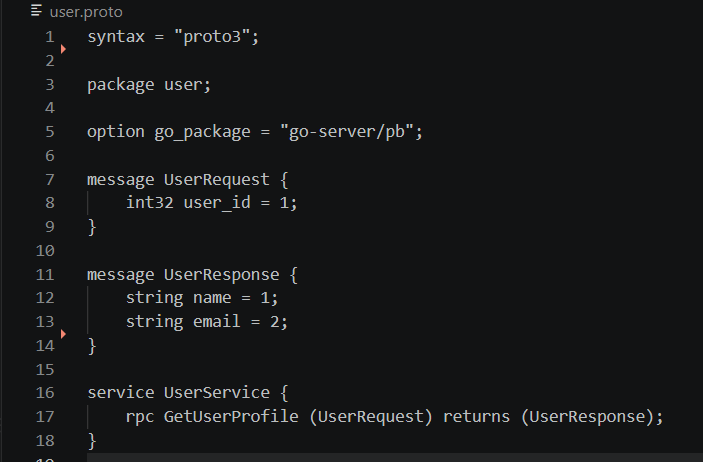
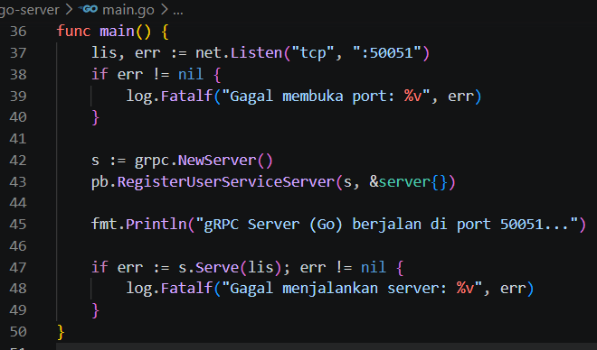
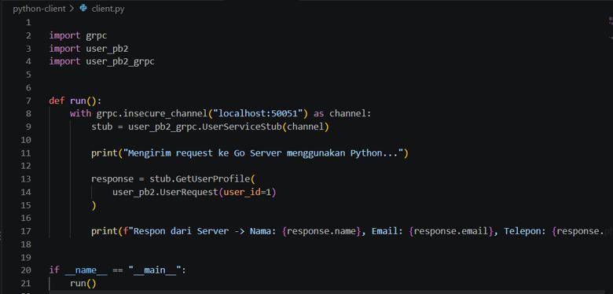
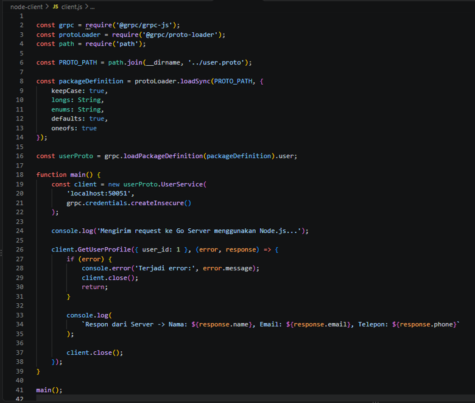
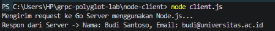
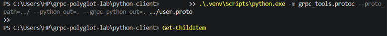

## LAPORAN PARKTIKUM PARADIGMA SISTEM UNTUK IT

### Disusun Oleh:  
Nama               : Mutiara Salsabila  
NIM                : 2024903430060  
Kelas              : TRKJ 3C

### Program Studi Teknologi Rekayasa Komputer Jaringan
### Jurusan Teknologi Informasi dan Komputer
### Politeknik Negeri Lhokseumawe
### 2026

---

## Lembar Pengesahan

| No. Praktikum     | : | 05 |
|------------------:|:-:|:--------------|
| Judul Praktikum   | : | Hands-on: Komunikasi Inter-service dengan gRPC (Polyglot)|
| Tanggal Praktikum | : | 19 Oktober 2026 |
| Tanggal Penyerahan| : | 19 Oktober 2026 |
| Nama Praktikan    | : | Mutiara Salsabila |
| NIM/Kelas Praktikan| : |2024903430060 / TRKJ 3C |
| Nilai Praktikum   | : | .......................... |
| Dosen Pengampu    | : | Muhammad Reza Zulman, S.ST., M.Sc. |

Mengetahui,  
Dosen Pengampu
     

Muhammad Reza Zulman, S.ST., M.Sc

## LAPORAN PARADIGMA SISTEM UNTUK IT

### Disusun Oleh:  
Nama               : Mutiara Salsabila  
NIM                : 2024903430060  
Kelas              : TRKJ 3C

### Program Studi Teknologi Rekayasa Komputer Jaringan
### Jurusan Teknologi Informasi dan Komputer
### Politeknik Negeri Lhokseumawe
### 2026

## Daftar Isi
- [Lembar Pengesahan](#lembar-pengesahan)
- [Daftar Isi](#daftar-isi)
- [Tujuan Praktikum](#tujuan-praktikum)
- [Dasar Teori](#dasar-teori)
- [Alat dan Bahan](#alat-dan-bahan)
- [Langkah Kerja](#langkah-kerja)
- [Hasil dan Pembahasan](#hasil-dan-pembahasan)
- [Kesimpulan](#kesimpulan)
- [Referensi](#referensi)

---
## TUJUAN PRAKTIKUM

Praktikum ini bertujuan untuk:

Memahami konsep komunikasi antar-layanan (inter-service communication) menggunakan gRPC.

Memahami penggunaan Protocol Buffers untuk mendefinisikan pesan dan layanan.

Mengimplementasikan Go Server sebagai penyedia layanan gRPC.

Mengimplementasikan Python Client dan Node.js Client untuk berkomunikasi dengan server.

Menguji pertukaran data antara server dan client yang menggunakan bahasa pemrograman berbeda.

Mengembangkan struktur pesan dengan menambahkan field nomor telepon.

Menggunakan Git dan GitHub untuk mengelola serta menyimpan kode praktikum.

## DASAR TEORI

1. gRPC

gRPC merupakan kerangka kerja komunikasi jarak jauh yang memungkinkan suatu aplikasi memanggil metode yang disediakan oleh aplikasi lain melalui jaringan. Dalam praktikum ini, gRPC digunakan untuk menghubungkan Go Server dengan Python Client dan Node.js Client.

Go Server menyediakan metode GetUserProfile, sedangkan kedua client mengirimkan permintaan berdasarkan ID pengguna dan menerima respons dari server.

2. Protocol Buffers

Protocol Buffers atau Protobuf merupakan mekanisme untuk mendefinisikan struktur pesan dan layanan secara terstruktur. Definisi tersebut disimpan dalam file berekstensi .proto.

File user.proto digunakan sebagai kontrak komunikasi antara server dan client. Berdasarkan file ini, kode pendukung dapat dihasilkan untuk bahasa pemrograman yang digunakan.

3. Go

Go merupakan bahasa pemrograman yang digunakan untuk membangun server pada praktikum ini. Go Server bertugas menerima permintaan, memproses ID pengguna, dan mengembalikan data pengguna melalui gRPC.

4. Python

Python digunakan untuk membangun client pertama. Python Client menggunakan pustaka grpcio serta kode hasil generasi Protocol Buffers untuk mengirim permintaan dan menerima respons dari Go Server.

5. Node.js

Node.js merupakan lingkungan eksekusi JavaScript yang digunakan untuk membangun client kedua. Client menggunakan pustaka @grpc/grpc-js untuk komunikasi gRPC dan @grpc/proto-loader untuk membaca definisi layanan dari file .proto.

6. Git dan GitHub

Git merupakan sistem pengelolaan versi yang digunakan untuk mencatat perubahan kode program. GitHub merupakan platform daring untuk menyimpan repository Git.

Dalam praktikum ini, Git dan GitHub digunakan untuk mengelola serta menyimpan kode server, client, dan definisi layanan.

## ALAT DAN BAHAN

1. Perangkat Keras

Laptop atau komputer.

Keyboard dan mouse.

Koneksi internet.

2. Perangkat Lunak

Sistem operasi Windows.

Visual Studio Code.

Go.

Python.

Node.js dan npm.

Protocol Buffers Compiler (protoc).

Plugin protoc-gen-go.

Plugin protoc-gen-go-grpc.

Pustaka Python grpcio dan grpcio-tools.

Pustaka Node.js @grpc/grpc-js dan @grpc/proto-loader.

Git.

GitHub.

## LANGKAH KERJA

1. Persiapan Lingkungan Praktikum

Praktikum dilakukan pada sistem operasi Windows menggunakan Visual Studio Code sebagai editor kode dan terminal PowerShell untuk menjalankan perintah.

Perangkat lunak yang dibutuhkan disiapkan terlebih dahulu, meliputi Go, Python, Node.js, Git, dan Protocol Buffers Compiler. Setelah itu, proyek dibuat pada direktori grpc-polyglot-lab.

Struktur utama proyek terdiri atas file user.proto serta tiga direktori, yaitu go-server, python-client, dan node-client.

2. Membuat File Protocol Buffers

File user.proto dibuat pada direktori utama proyek. File ini mendefinisikan pesan permintaan, pesan respons, dan layanan yang digunakan dalam komunikasi gRPC.

Kode awal user.proto:

syntax = "proto3";

package user;

option go_package = "go-server/pb";

message UserRequest {
    int32 user_id = 1;
}

message UserResponse {
    string name = 1;
    string email = 2;
}

service UserService {
    rpc GetUserProfile (UserRequest) returns (UserResponse);
}

Keterangan:

UserRequest berisi ID pengguna.

UserResponse berisi nama dan email pengguna.

UserService mendefinisikan layanan gRPC.

GetUserProfile digunakan untuk meminta informasi pengguna.

Gambar 1. Definisi pesan dan layanan gRPC pada file user.proto.

Foto yang digunakan: proto(1).png.

3. Implementasi Go Server

Go Server dibuat di dalam direktori go-server. Server menyediakan metode GetUserProfile yang dapat dipanggil oleh client.

Kode hasil generasi Protocol Buffers dibuat dengan perintah:

protoc --proto_path=../ --go_out=. --go_opt=module=go-server --go-grpc_out=. --go-grpc_opt=module=go-server ../user.proto

Perintah tersebut menghasilkan file user.pb.go dan user_grpc.pb.go pada direktori pb.

Implementasi server ditulis dalam file main.go. Server membuka koneksi TCP pada port 50051, mendaftarkan layanan UserService, dan menunggu permintaan dari client.

Gambar 2. Implementasi Go Server pada file main.go.

Foto yang digunakan: main_go(1).png.

4. Menjalankan Go Server

Server dijalankan dari direktori go-server menggunakan perintah:

go run main.go

Ketika berhasil dijalankan, terminal menampilkan pesan bahwa gRPC Server berjalan pada port 50051. Server dibiarkan tetap berjalan selama proses pengujian client.

Gambar 3. Go Server berjalan pada port 50051 dan menerima permintaan dari client.

Foto yang digunakan: go run main.go(1).png.

5. Implementasi Python Client

Python Client dibuat pada direktori python-client. Kode pendukung Protocol Buffers dihasilkan menggunakan perintah:

.\.venv\Scripts\python.exe -m grpc_tools.protoc --proto_path=../ --python_out=. --grpc_python_out=. ../user.proto

Perintah tersebut menghasilkan file user_pb2.py dan user_pb2_grpc.py.

Python Client menggunakan pustaka grpc untuk membuka koneksi ke localhost:50051. Client kemudian memanggil metode GetUserProfile dengan mengirimkan user_id=1.

Gambar 4. Implementasi Python Client pada file client.py.

6. Implementasi Node.js Client

Node.js Client dibuat pada direktori node-client. Pustaka yang digunakan adalah @grpc/grpc-js dan @grpc/proto-loader.

Client membaca definisi layanan dari file user.proto, membuat koneksi ke localhost:50051, kemudian memanggil metode GetUserProfile dengan ID pengguna 1.

Gambar 5. Implementasi Node.js Client pada file client.js.

7. Pengujian Awal Node.js Client

Setelah Go Server berjalan, Node.js Client dijalankan menggunakan perintah:

node client.js

Hasil pengujian awal menunjukkan bahwa client dapat menerima nama dan email pengguna dari server.

Gambar 6. Hasil pengujian awal Node.js Client yang menampilkan nama dan email pengguna.

8. Pembuatan Kode Python

Untuk menggunakan definisi layanan dari user.proto, kode Python dibuat menggunakan grpc_tools.protoc. Proses ini menghasilkan kode pesan dan layanan yang diperlukan oleh Python Client.

Perintah yang digunakan:

.\.venv\Scripts\python.exe -m grpc_tools.protoc --proto_path=../ --python_out=. --grpc_python_out=. ../user.proto

Setelah kode berhasil dibuat, file hasil generasi digunakan oleh client.py.

Gambar 7. Proses pembuatan kode Python berdasarkan file user.proto.

9. Menambahkan Field Phone

Setelah komunikasi awal berhasil, struktur pesan UserResponse dikembangkan dengan menambahkan field nomor telepon.

Perubahan pada file user.proto:

message UserResponse {
    string name = 1;
    string email = 2;
    string phone = 3;
}

Field phone menggunakan nomor field 3, sedangkan field name dan email tetap menggunakan nomor 1 dan 2.

Setelah perubahan disimpan, kode hasil generasi Go dan Python dibuat ulang. Go Server diperbarui untuk mengirimkan nomor telepon contoh 081234567890, sedangkan kedua client diperbarui untuk menampilkan nilai phone.

Pengujian dilakukan kembali setelah server dijalankan ulang.

Catatan: dokumentasi foto yang tersedia menunjukkan kode client yang sudah menampilkan phone, tetapi foto user.proto yang dikirim masih memperlihatkan struktur awal tanpa field phone. Karena itu, screenshot user.proto setelah perubahan perlu ditambahkan jika tersedia.

10. Pengelolaan Proyek Menggunakan Git dan GitHub

Proyek disimpan dalam repository GitHub dengan alamat:

https://github.com/Mutiarasalsabila04/grpc-polyglot-lab

Git digunakan untuk menambahkan file, membuat commit, dan mengelola branch. GitHub digunakan untuk menyimpan kode proyek secara daring.

File proyek yang disimpan meliputi kode Go Server, Python Client, Node.js Client, file hasil generasi Protocol Buffers, serta file user.proto.

## HASIL DAN PEMBAHASAN

1. Hasil Pengujian Go Server

Go Server berhasil dijalankan pada port 50051. Terminal juga menunjukkan log permintaan yang diterima dari client dengan ID pengguna 1.

Hal ini menunjukkan bahwa server telah berjalan dan menerima permintaan selama pengujian.

Bukti pengujian ditampilkan pada Gambar 3.

2. Hasil Pengujian Python Client

Python Client berhasil mengirim permintaan kepada Go Server menggunakan metode GetUserProfile. Setelah field phone ditambahkan dan kode diperbarui, output yang diharapkan adalah nama, email, dan nomor telepon pengguna.

Output akhir yang telah diperoleh saat pengujian:

Mengirim request ke Go Server menggunakan Python...
Respon dari Server -> Nama: Budi Santoso, Email: budi@universitas.ac.id, Telepon: 081234567890

Hasil ini menunjukkan bahwa Python Client dapat menerima struktur respons yang telah diperluas.

3. Hasil Pengujian Node.js Client

Node.js Client berhasil mengirim permintaan kepada Go Server dan menerima respons.

Pada pengujian awal, terminal menampilkan nama dan email pengguna. Setelah penambahan field phone, client diperbarui untuk menampilkan nomor telepon.

Output akhir yang telah diperoleh saat pengujian:

Mengirim request ke Go Server menggunakan Node.js...
Respon dari Server -> Nama: Budi Santoso, Email: budi@universitas.ac.id, Telepon: 081234567890

Hasil ini menunjukkan bahwa Node.js Client dapat menerima data dari Go Server setelah struktur pesan diperbarui.

4. Analisis

Berdasarkan pengujian, Go Server dapat melayani permintaan dari Python Client dan Node.js Client menggunakan kontrak layanan yang sama.

Protocol Buffers membantu menyamakan struktur permintaan dan respons antarbahasa pemrograman. Penambahan field phone menunjukkan bahwa struktur pesan dapat dikembangkan sesuai kebutuhan, dengan memperbarui definisi .proto, menghasilkan ulang kode yang diperlukan, dan menyesuaikan implementasi server serta client.

Praktikum ini menerapkan pendekatan polyglot karena server dan client dikembangkan menggunakan bahasa pemrograman berbeda.

5. Repository GitHub

Proyek praktikum telah disimpan pada repository:

https://github.com/Mutiarasalsabila04/grpc-polyglot-lab

Repository menampilkan direktori go-server, python-client, dan node-client, serta file .gitignore dan user.proto.

Repository tersebut menjadi tempat penyimpanan kode praktikum secara daring. Isi file perlu diperiksa untuk memastikan seluruh perubahan terbaru telah tersimpan.

KESIMPULAN

Berdasarkan praktikum yang telah dilakukan, dapat disimpulkan bahwa:

gRPC dapat digunakan untuk membangun komunikasi antar-layanan melalui jaringan.

Protocol Buffers digunakan untuk mendefinisikan pesan dan layanan yang dipakai bersama oleh server dan client.

Go Server berhasil menyediakan layanan GetUserProfile pada port 50051.

Python Client berhasil berkomunikasi dengan Go Server dan menerima data pengguna.

Node.js Client berhasil mengakses layanan yang sama menggunakan bahasa pemrograman berbeda.

Penambahan field phone berhasil diterapkan pada struktur pesan, server, dan kedua client.

Git dan GitHub digunakan untuk mengelola serta menyimpan kode proyek secara daring.

Dengan demikian, praktikum ini menunjukkan implementasi komunikasi inter-service menggunakan gRPC dengan pendekatan polyglot.

## REFERENSI

gRPC. gRPC Documentation. https://grpc.io/docs/

Protocol Buffers. Protocol Buffers Documentation. https://protobuf.dev/

Go. The Go Programming Language Documentation. https://go.dev/doc/

Python Software Foundation. Python Documentation. https://docs.python.org/3/

Node.js. Node.js Documentation. https://nodejs.org/docs/

Git. Git Documentation. https://git-scm.com/doc/

GitHub. GitHub Documentation. https://docs.github.com/
